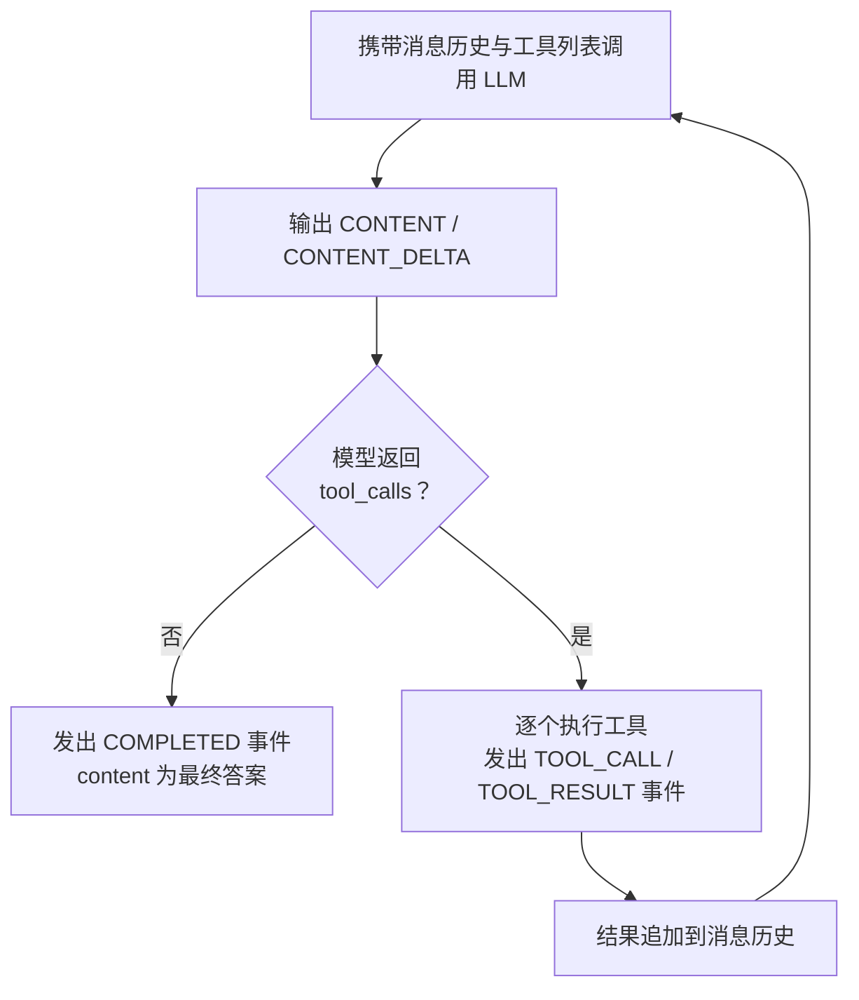

# ReAct 智能体

ReAct（Reasoning + Acting）是目前构建智能体的经典范式：模型在循环中不断「思考—调用工具—观察结果」，直到能够给出最终答案。`ReActAgentExecutor` 就是这个范式的实现，它把循环编排、工具调度、消息历史维护都封装起来，我们只需要提供客户端、工具和初始消息。单轮循环的执行流程如下。



## 基本用法

```java
ReActAgentExecutor agent = ReActAgentExecutor.builder()
        .defaultLlmClient(llmClient)
        .toolRegistry(toolRegistry)
        .defaultToolNames(List.of("query_weather"))
        .maxIterations(30)
        .build();

Flux<AgentResponse> events = agent.execute(AgentContext.builder()
        .contextId("session-001")
        .messages(List.of(
                new SystemMessage("你是一个天气助手"),
                new UserMessage("北京今天天气怎么样？")))
        .build());
```

执行器的几个构建参数：

- `defaultLlmClient`：默认的 LLM 客户端，`AgentContext` 中未指定客户端时使用
- `toolRegistry`：工具注册中心，注入 Starter 自动装配的 Bean 即可
- `defaultToolNames`：默认启用的工具名列表，`AgentContext` 中未指定工具时使用
- `maxIterations`：最大循环轮数，默认 50，超限后以 `ERROR` 事件结束，防止模型陷入死循环
- `convergenceMode`：循环收敛方式，默认 `ConvergenceMode.NO_TOOL_CALL`，即模型不再调用工具时直接结束；也可设为 `FINAL_ANSWER` 强制使用内置工具提交答案

`execute` 返回 `Flux<AgentResponse>` 事件流。执行过程在 `boundedElastic` 调度器上异步进行。

## 执行上下文 AgentContext

`AgentContext` 承载一次智能体执行的全部状态。

| 字段 | 说明 |
|---|---|
| `contextId` | 会话上下文 ID，框架不消费，供业务侧关联会话 |
| `messages` | 消息列表，执行过程中会不断追加助手消息和工具结果 |
| `llmClient` | 本次执行使用的客户端，为 `null` 时使用执行器的默认客户端 |
| `toolNames` | 本次执行启用的工具名列表，为空时使用执行器的默认工具列表 |
| `temperature` / `topP` / `topK` / `presencePenalty` / `frequencyPenalty` / `seed` / `maxTokens` | 采样参数，语义与 `ChatRequest` 一致 |
| `enableThinking` | 是否开启思考，前提是模型声明了 `reasoning` 能力 |
| `reasoningEffort` | 推理强度，语义与 `ChatRequest` 一致，默认不传递该字段 |
| `streaming` | 是否流式输出思考与模型正文，默认 `false` |
| `variables` | 自定义变量 Map，供工具读写共享状态 |

`messages` 是可变的：执行器每轮会把模型的助手消息和工具执行结果追加进去。执行结束后，我们可以通过 `context.getMessages()` 拿到完整的对话历史，用于持久化或下一次续聊。

`variables` 是工具之间共享状态的通道。工具方法声明 `AgentContext` 参数后，会拿到执行时点的上下文快照，对快照中 `variables` 的修改会在工具执行完成后合并回主上下文。消息列表等其它字段的修改则不会回传，这是有意的防御性设计，避免工具误改对话状态。一个典型的用法是让工具记录执行过程中的业务数据，供后续工具或业务代码消费。

```java
@AgenticTool(name = "query_order", description = "查询订单")
public String queryOrder(OrderQuery query, AgentContext ctx) {
    Order order = orderService.get(query.getOrderNo());
    ctx.getVariables().put("currentOrder", order); // 共享给后续工具
    return toJson(order);
}
```

由于上下文中可以切换客户端和工具列表，同一个执行器实例可以服务多个模型、多套工具组合，每次执行通过 `AgentContext` 隔离。

## 事件流 AgentResponse

智能体的每一步进展都会以 `AgentResponse` 事件的形式从事件流中发出，事件类型如下。

| 事件类型 | 说明 | 产生的时机 |
|---|---|---|
| `THINKING` | 思考内容（reasoning） | 每轮模型返回了思考内容时（完整内容） |
| `CONTENT` | 模型正文（content） | 每轮模型返回了正文时，不区分中间步骤与最终答案 |
| `TOOL_CALL` | 发起工具调用 | 模型决定调用工具时，携带 toolCallId、toolName、toolArguments |
| `TOOL_RESULT` | 工具执行结果 | 工具执行完成后，携带 toolCallId、toolName、结果文本 |
| `COMPLETED` | 正常执行完成 | Agent Loop 正常结束，`content` 为最终答案 |
| `ERROR` | 执行出错 | 循环内抛出异常或达到最大轮数时 |
| `THINKING_DELTA` | 思考内容增量片段 | 仅 `streaming=true` 时，随流式分片实时产生 |
| `CONTENT_DELTA` | 模型正文增量片段 | 仅 `streaming=true` 时，随流式分片实时产生，不区分中间步骤与最终答案 |
| `STOPPED` | 执行被停止 | `requestStop()` 请求停止生效时，发出后事件流正常完成 |
| `SUSPENDED` | 执行被挂起 | 工具调用拦截器或工具抛出 `AgentSuspendException` 时，发出后事件流正常完成，可持久化上下文后再次 `execute` 恢复 |

前端对接时，一般按事件类型分别渲染：思考内容放到折叠区域，工具调用展示为执行步骤，所有 `CONTENT` / `CONTENT_DELTA` 都作为模型正文处理。`COMPLETED` 是正常结束的明确信号，只关心最终结果的调用方可以直接读取它的 `content`，不需要自行判断哪一轮正文是最终答案。

## 流式模式

`AgentContext.streaming` 默认为 `false`，此时每轮的思考和正文在模型完整返回后一次性以 `THINKING` / `CONTENT` 事件发出。设置为 `true` 后，执行器改用流式调用，并实时发出 `THINKING_DELTA` 和 `CONTENT_DELTA` 两种增量事件。

正文事件不区分中间步骤和最终答案，因此执行器无需等到本轮结束后才能判断 Delta 类型，所有 `content` 分片都可以立即输出。即使模型先输出一段正文、随后发起工具调用，这段正文也不会被错误标记成最终答案。

无论是否开启流式，每轮结束时完整的 `THINKING`、`CONTENT`、`TOOL_CALL`、`TOOL_RESULT` 事件依然会照常发出。Delta 用于打字机渲染，完整事件用于非流式消费或存档；渲染方不应把同一轮的 `CONTENT_DELTA` 和 `CONTENT` 重复拼接。正常结束时最后再发出 `COMPLETED`，其 `content` 是最终答案。

## 循环收敛

执行器通过 `convergenceMode` 支持两种收敛方式。

### NO_TOOL_CALL（默认）

默认使用现代模型常见的自然收敛方式，不向模型注入额外的结束工具。某一轮没有返回 `tool_calls`，且响应以 `stop` 正常结束、正文非空白时，该轮正文就是最终答案，执行器发出 `COMPLETED` 并结束循环；有工具调用时则执行工具并继续下一轮。中间步骤和最终步骤的模型正文统一通过 `CONTENT` / `CONTENT_DELTA` 返回。

自然收敛不会把无效响应当作答案：无工具调用但正文为 null、空字符串或纯空白时发出 `ERROR`；`length`、`content_filter` 等异常结束原因同样发出 `ERROR`，不会用 `COMPLETED` 交付空答案或截断内容。

### FINAL_ANSWER

需要兼容较早的模型或强制答案提交协议时，可以显式启用内置 `final_answer` 工具：

```java
ReActAgentExecutor agent = ReActAgentExecutor.builder()
        .defaultLlmClient(llmClient)
        .toolRegistry(toolRegistry)
        .convergenceMode(ConvergenceMode.FINAL_ANSWER)
        .build();
```

该模式会把 `final_answer` 加入工具列表，模型调用它后，执行器提取 `message` 参数并通过 `COMPLETED.content` 返回最终答案。工具参数不作为模型正文，因此不会产生 `CONTENT_DELTA`。如果模型只返回正文而没有调用工具，执行器会追加提醒消息，要求它调用业务工具继续或调用 `final_answer` 结束。

另外，执行器对异常场景做了兜底：如果模型返回中残留了未执行的 tool_calls（例如因 `length` 截断而结束），框架会自动补上对应的工具结果消息并注明未执行的原因，保证消息历史中每个 tool_call 都有配对的结果——否则下一轮请求会直接被端点拒绝；工具参数不是合法 JSON 时（典型的截断场景），不会真正执行工具，而是把错误信息作为工具结果反馈给模型。

## 停止与取消

执行提供两种停止方式，分别对应「业务主动停止」与「订阅方放弃」两类场景。

### 请求停止：requestStop

`AgentContext.requestStop()` 是业务侧主动停止执行的入口，典型用法是响应用户的「停止」按钮：

```java
AgentContext context = AgentContext.builder()
        .messages(List.of(new UserMessage("帮我分析这份日志")))
        .build();
Flux<AgentResponse> events = executor.execute(context);

// 业务侧需要停止时调用，线程安全
context.requestStop();
```

请求停止后，执行器在以下协作点生效：每一轮循环开始前、每次 LLM 调用返回后、每个工具执行前、流式接收的每个分片处。生效时事件流发出一个 `STOPPED` 事件并正常完成，订阅方据此即可区分「正常结束」与「被停止」。

停止过程的几个保证：

- **消息历史保持完整**：停止时本轮尚未执行的 tool_call 会自动补上注明取消的工具结果消息，历史中每个 tool_call 都有配对结果，上下文可直接用于再次 `execute` 续聊
- **流式中的部分响应会被丢弃**：停止时正在接收的模型响应不写入消息历史（已发出的增量事件不受影响），避免历史中残留参数截断一半的 tool_call
- **工具可感知停止**：工具方法声明的 `AgentContext` 参数与主上下文共享停止标志，耗时工具可以自行轮询 `isStopRequested()` 提前返回

### 取消订阅：dispose

订阅方调用 `Disposable.dispose()`（或 `take(n)` 截断、WebFlux 请求断开等）同样会停止执行，协作点与 `requestStop` 相同，流式模式下会向上游传播取消并主动关闭 SSE 连接。区别在于这是放弃式的：事件流直接终止，`STOPPED` 事件随订阅的消失而无法送达，执行器在后台收尾到下一个协作点后退出。消息历史的配对完整性同样有保障。

### 共同边界

两种方式都是协作式的：**正在执行中的工具方法不会被中断**（Java 无法安全中断任意业务代码），它会执行完毕，只是后续的循环和工具调用不再继续。耗时或高危工具应自行支持中断（轮询停止标志、销毁子进程等），或拆分为可轮询的两段式操作。如需可恢复的暂停而非停止，请使用智能体拦截器的 `suspendWith`（见「智能体拦截器」一章）。

## 运行期行为的提示

执行器中工具调用是同步执行的，事件发射与工具执行在同一个 `boundedElastic` 线程上。如果工具本身耗时较长（如调用慢速的外部接口），整轮循环会被拉长，这是 ReAct 范式的固有特性；如果业务对延迟敏感，应尽量让工具内部实现保持轻量，重活异步化后通过 `variables` 或轮询类工具获取结果。
